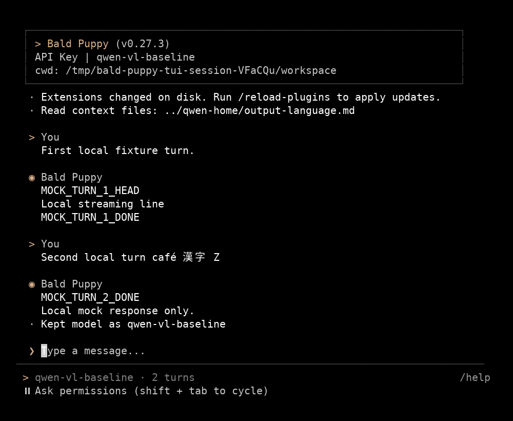

# Bald Puppy

Agente de terminal basado en [Qwen Code](https://github.com/QwenLM/qwen-code), con una interfaz inspirada en [Zyn-Old](https://github.com/toZyn/Zyn-Old): panel compacto, mensajes con cabeceras `> You` y `◉ Bald Puppy`, entrada `❯` sin caja, eventos discretos, selección `▸` y barra de estado compacta. El acento ámbar se reserva para la interacción; las herramientas usan violeta.

## Instalar desde el código

Requiere Node.js 22 o superior y Corepack.

```bash
git clone https://github.com/toZyn/Bald-Puppy.git
cd Bald-Puppy
corepack pnpm install --frozen-lockfile
npm link
bald-puppy
```

La instalación compila y empaqueta el agente. `qwen` sigue disponible como alias. Para desarrollo: `npm run dev`. Para recompilar: `npm run build && npm run bundle`.

Se conservan los proveedores, autenticación, herramientas, permisos, MCP, sesiones, comandos y configuración de Qwen Code. Los ajustes continúan en `~/.qwen`; no se importan configuraciones antiguas de Codex. El tema oscuro predeterminado mantiene la clave `Qwen Dark` para compatibilidad; `/theme` permite cambiarlo. El modo sin colores y el lector de pantalla siguen disponibles.

La interfaz usa el renderizador de Qwen Code para conservar edición Unicode, pegado, streaming y redimensionamiento; no reutiliza el bucle de entrada de Zyn-Old. No se garantiza ausencia total de errores ni compatibilidad Android de todas las dependencias nativas.

## Verificación de la interfaz

El fallo de bordes fantasma se reproduce en una terminal PTY con un modelo local simulado y conexiones externas bloqueadas. La prueba comprueba un único encabezado tras redimensionar, dos turnos, edición Unicode, menús y selección de modelo. No requiere una API real.

```bash
npx vitest run --root integration-tests interactive/tui-header-repaint.test.ts --maxWorkers=1 --minWorkers=1 --retry=0
```

Capturas del ejecutable real, reconstruidas desde las celdas de la terminal:



[Captura de 40 columnas y método](docs/images/bald-puppy-terminal-capture.md). El diálogo de modelos necesita más de 10 filas para mostrar todas las indicaciones. La prueba automatizada se ejecuta en Linux; queda pendiente la comprobación nativa en Termux.

## Procedencia

Base: QwenLM/qwen-code, commit `038b60e3099a174395f26ed0d1b501eb04d2302d` (0.27.3). El código anterior de Bald-Puppy queda recuperable en el historial de Git. Se conserva la licencia Apache-2.0 y los avisos del proyecto base. Consulta [la documentación original](README.upstream.md).
