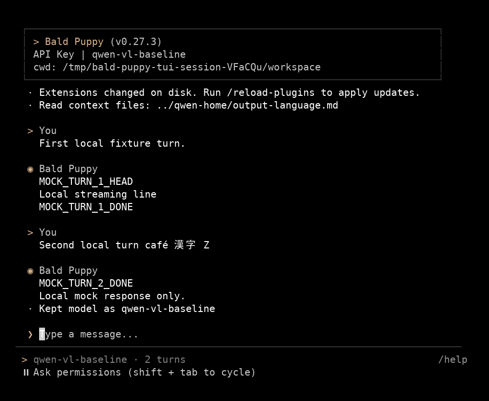
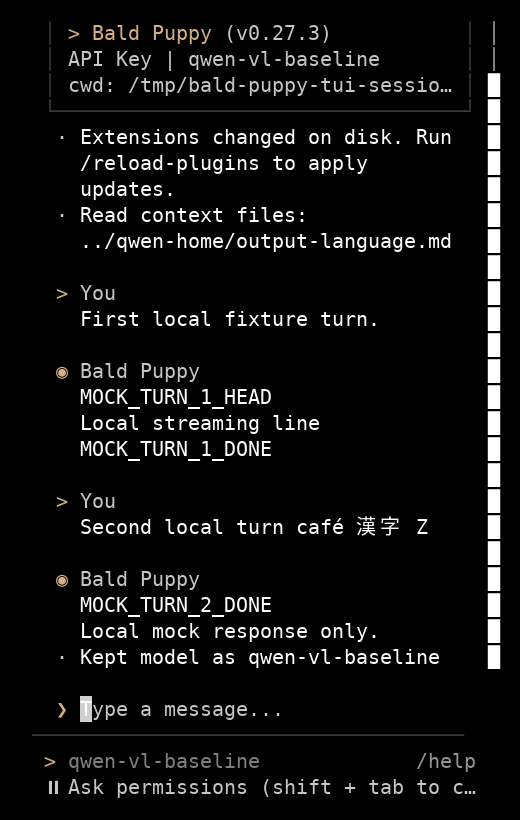

These previews show actual processed xterm cells captured from the built CLI during a loopback-only mock test. All displayed model responses are deterministic fixtures. No live model or external service was contacted.

The PNGs use the captured foreground/background attributes. Unspecified colors use the emulator's stated default theme: white foreground on black background. Font rasterization uses DejaVu Sans Mono with Noto fallbacks; no product text, controls or layout were added. The 40-column capture preserves the transcript's observed scrollbar and partial header at its current scroll position.

To refresh after building the CLI, run the focused integration suite with `TUI_FIDELITY_OUT` pointing to an evidence directory, then pass the successful `extended-*` directory to `integration-tests/interactive/fixtures/render-tui-cells.py`.
